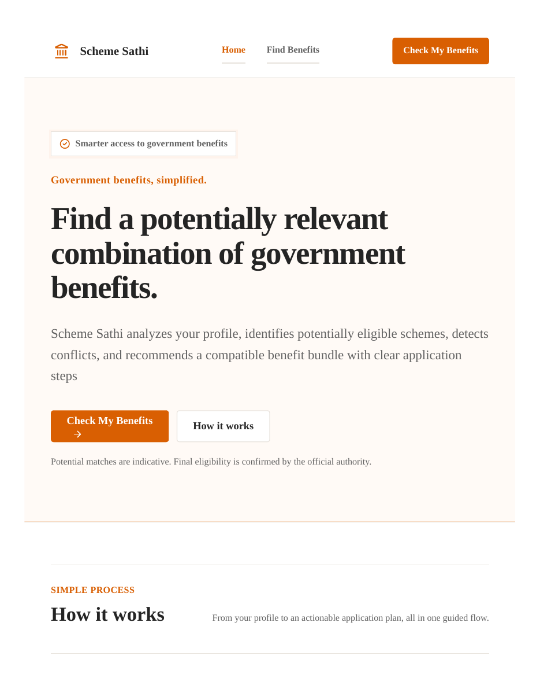
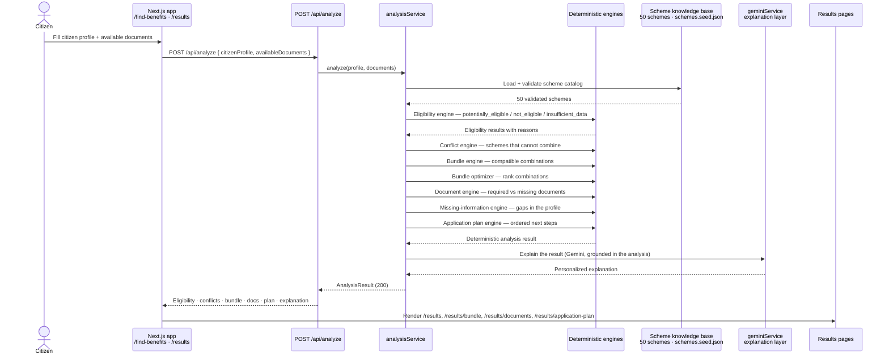
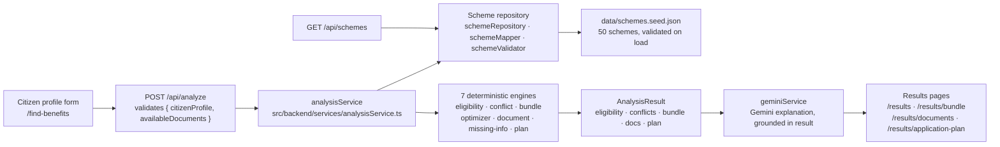
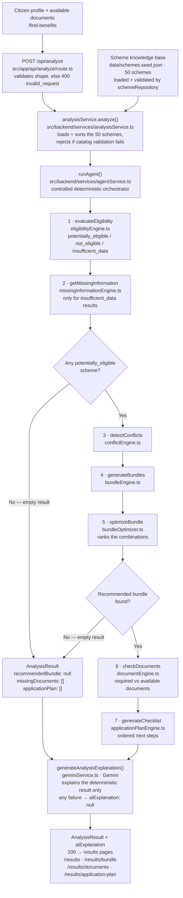
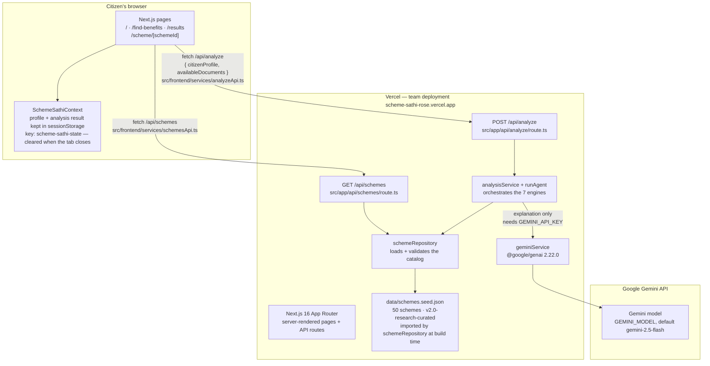
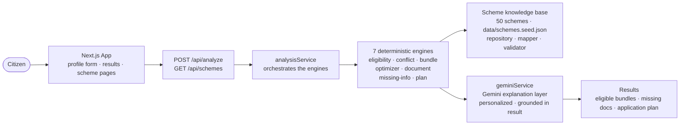

# Skill Sathi

**Smarter access to government benefits.**

Live demo (team deployment): https://scheme-sathi-rose.vercel.app

Skill Sathi (original project name: Scheme Sathi) is a citizen decision-support system. It helps a person understand which government schemes they may qualify for, which schemes can work together, which combination is most useful, what documents are missing, and what to do next.

It was built as a team hackathon project for PS16 — Autonomous Scheme-Bundle Optimizer for Citizens (AI/ML + Agentic AI + GovTech).

> **Important:** Skill Sathi is not a government authority and does not submit applications on behalf of citizens. Results say **“Potentially Eligible”**, not “Officially Eligible”. Eligibility is based on configured scheme rules and must be confirmed with the official authority before applying.

## Screenshots



Home page — 'Find a potentially relevant combination of government benefits.' with the Check My Benefits call to action. Screenshot of the live demo, 20 Nov 2026.

## The five questions it answers

1. Which schemes may I qualify for?
2. Which schemes can work together?
3. Which combination is most useful for me?
4. What documents am I missing?
5. What should I do next?

## How it works — the core flow



The step order above follows the pipeline documented in this README. The route itself (`src/app/api/analyze/route.ts`) only validates the request shape and calls `analyze()` in `src/backend/services/analysisService.ts`; the engine-by-engine order inside that service was not traced line by line for this README.

**Deterministic rules decide eligibility and compatibility. AI is only the explanation layer.** That is the core design rule: government eligibility facts are decided by deterministic code, not by the language model. Gemini is used for orchestration, personalization, and explanation of the deterministic result.

```text
Citizen Profile
      ↓
Scheme Knowledge Base
      ↓
Eligibility Engine
      ↓
Conflict Detection
      ↓
Bundle Generation
      ↓
Bundle Optimization
      ↓
Document Check
      ↓
Application Plan
      ↓
Personalized Explanation
```

## What it does

- **Citizen profile form** — only the information required for the analysis is collected.
- **Curated scheme knowledge base** — 50 Maharashtra state + Central Government schemes applicable in Maharashtra, in `data/schemes.seed.json` (research-curated, 2026-09-12; official government portals prioritized). This is a curated hackathon dataset, not the complete Indian scheme ecosystem.
- **Deterministic eligibility evaluation** — results use only `potentially_eligible`, `not_eligible`, or `insufficient_data`, with reasons the user can read.
- **Conflict detection** — identifies schemes that cannot be combined.
- **Compatible bundle generation and optimization** — builds and ranks combinations of schemes that can work together.
- **Document readiness** — lists the documents a bundle needs and which ones are missing.
- **Application plan** — ordered next steps for each recommended bundle.
- **Scheme details** — a page per scheme at `/scheme/[schemeId]`, with source and trust information.
- **Gemini-generated explanation** — a personalized explanation of the result, grounded in the deterministic analysis.

## The scheme dataset

Verified against `data/schemes.seed.json` (head `25caf2e45`):

| Field | Value |
|---|---|
| Dataset | Scheme Sathi - Maharashtra First + Central Government Scheme Dataset |
| Version | 2.0-research-curated |
| Scope | Maharashtra state schemes plus Central Government schemes applicable in Maharashtra |
| Research date | 2026-09-12 |
| Schemes | 50, all with unique IDs (`MH001` … `IN050`) |
| Source policy | Official government portals prioritized; detailed eligibility should be re-verified before production use |

Every scheme carries the same shape: `id`, `name`, `level`, `state`, `category`, `target_groups`, `eligibility`, `benefit`, `documents`, `conflicts`, `source_url`, `data_status`, `verification_note`. First entry: `MH001` — Rajarshi Chhatrapati Shahu Maharaj Shikshan Shulkh Shishyavrutti Scheme. Last entry: `IN050` — Post Matric Scholarship for Students with Disabilities.

## Pages

| Route | What it is |
| --- | --- |
| `/` | Home — the five-step journey and what the tool does |
| `/find-benefits` | Citizen profile form |
| `/analysis` | Analysis in progress / result summary |
| `/results` | Eligibility, conflicts, and recommended bundle |
| `/results/bundle` | Recommended bundle detail |
| `/results/documents` | Document readiness and missing documents |
| `/results/application-plan` | Ordered application steps |
| `/scheme/[schemeId]` | Single scheme detail |

The live demo loads all of this: the home page shows the five-step journey (Profile → Eligibility → Conflicts → Recommended Bundle → Application Plan) and a “Check My Benefits” entry point.

## API

- `GET /api/schemes` — returns the curated scheme catalog. Returns a `scheme_catalog_unavailable` error if catalog validation fails.
- `POST /api/analyze` — accepts `{ citizenProfile, availableDocuments }` and returns eligibility results, conflicts, the recommended bundle (or `null`), missing documents, and the application plan. Errors: `invalid_request` (400, bad shape or invalid JSON) and `internal_error` (500, the analysis service could not complete the request).

## Data flow



- **Deterministic first:** eligibility, conflicts, bundles, documents and the plan are computed by the engines in `src/backend/engines/` from the validated catalog. They do not depend on Gemini.
- **AI last, and optional:** `geminiService` (`src/backend/services/geminiService.ts`) only explains the deterministic result. It needs `GEMINI_API_KEY`; without a key there is no Gemini-generated explanation, but the analysis itself still runs.
- **No persistence:** there is no database in this project. The catalog is a JSON file, and results are computed per request — nothing about the citizen is stored server-side by the app itself.

### The analysis pipeline, traced from the code

The diagram above shows the documented pipeline. This one is the exact order in code — `analyze()` in `src/backend/services/analysisService.ts` hands the work to `runAgent()` in `src/backend/services/agentService.ts`, which runs the seven engine tools in this order through the tool registry in `src/backend/agent/agentTools.ts` (each tool wraps one engine file in `src/backend/engines/`). Gemini runs last, and only explains the result.



Two early exits: if no scheme is potentially eligible, or no bundle can be recommended, the run stops with an empty result (bundle `null`, empty documents and plan) — the Gemini explanation still runs on that empty result, and the API still returns 200.

## Deployment — where everything runs



- **One host, no database:** the whole app — pages, API routes, engines, and the JSON dataset — runs on Vercel. There is no database server and no other backend service.
- **Browser state is session-only:** the profile and the last analysis result live in `sessionStorage` (`SchemeSathiContext`, `src/frontend/context/SchemeSathiContext.tsx`), not `localStorage` — closing the tab clears them. Nothing about the citizen is stored server-side.
- **Gemini is an outbound call, not a host:** `geminiService` calls the Google Gemini API from the Vercel server. Without `GEMINI_API_KEY` there is no explanation, but the deterministic analysis still runs and returns 200.

## Tech stack

Verified from `package.json` (head `25caf2e45`):

| Layer | Choice |
|---|---|
| Framework | Next.js 16.3.4 (App Router) · React 19.2.8 · TypeScript 5 |
| Styling | Tailwind CSS 4 · `tailwind-merge` 3.6.0 · `clsx` 2.1.1 · `class-variance-authority` 0.7.1 |
| UI | shadcn/ui (`components.json` present) · Lucide icons 1.44.0 |
| AI | Gemini API via `@google/genai` 2.22.0 (`GEMINI_MODEL`, default `gemini-2.5-flash`) |
| Data | JSON knowledge base (`data/schemes.seed.json`) — no database |
| Lint | ESLint 9 · `eslint-config-next` 16.3.4 |

Business logic is plain TypeScript in `src/backend/`; the knowledge base is JSON. See `package.json` for the full list.

## Start locally

Prerequisites: Node.js 20+ and npm.

```bash
npm install
cp .env.example .env.local
npm run dev
```

Then open `http://localhost:3000`.

On Windows PowerShell, use `Copy-Item .env.example .env.local` instead of `cp`.

### Environment variables

Copy `.env.example` to `.env.local` and fill in real values. Never commit `.env.local`.

- `GEMINI_API_KEY` — server-side Gemini key, used for the explanation layer. Required for Gemini-generated explanations.
- `GEMINI_MODEL` — Gemini model name (example in `.env.example`: `gemini-2.5-flash`).

Eligibility, conflicts, and bundle logic do not depend on Gemini; they run on the deterministic engines in `src/backend/engines/`.

## Quality checks

```bash
npm run lint
npm run build
```

There is no test script in `package.json` and no test runner configured — `lint` and `build` are the only automated checks.

## Architecture



## Project structure

```text
src/app/              Pages and API routes (profile, analysis, results, scheme detail)
src/app/api/          analyze, schemes
src/backend/          Deterministic engines, data layer, services, and agent code
src/backend/agent/    agentTools.ts, agentTypes.ts
src/backend/agents/   (empty placeholder — .gitkeep only)
src/backend/ai/       (empty placeholder — .gitkeep only)
src/backend/data/     schemeRepository, schemeMapper, schemeValidator (+ examples)
src/backend/engines/  7 engines + eligibilityRuleNormalizer, each with .examples.ts
src/backend/services/ analysisService, agentService, geminiService (+ examples)
src/backend/validation/ (empty placeholder — .gitkeep only)
src/components/       analysis, application, bundle, documents, home, layout, profile, results, schemes, ui
src/frontend/         context, services, utils
src/lib/              utils.ts
src/types/            analysis-types.ts, citizen-profile.ts, scheme-types.ts
data/                 Curated scheme dataset (schemes.seed.json — 50 schemes)
docs/                 PRD, API_CONTRACT, TECHNICAL_REQUIREMENTS, README-reference
screenshots/          (empty — .gitkeep only, no screenshots exist yet)
```

See [docs/PRD.md](docs/PRD.md), [docs/API_CONTRACT.md](docs/API_CONTRACT.md), and [docs/TECHNICAL_REQUIREMENTS.md](docs/TECHNICAL_REQUIREMENTS.md) for the full product and technical detail. Note that `docs/API_CONTRACT.md` describes the analysis contract as future work in places; the `POST /api/analyze` route is implemented in `src/app/api/analyze/route.ts`.

## Screenshots

See [Screenshots](#screenshots) near the top of this README — the home page capture lives at `docs/screenshots/home.png`. More captures (profile form, results page) can be added to the same folder.

## Honest limits

- The scheme dataset is curated and research-based. Detailed eligibility, income limits, dates, and document requirements change — always re-verify on the official portal or with the issuing authority before applying.
- Results are decision support, not an official eligibility decision and not an application submission.
- Only minimal profile data is collected for the analysis, and nothing is stored server-side — there is no database.
- Gemini explanations need `GEMINI_API_KEY`. Without it, the deterministic analysis still runs but there is no AI-generated explanation.
- No test suite — `package.json` has no test script and no test runner is configured.
- Three backend directories are empty placeholders (`.gitkeep` only): `src/backend/ai/`, `src/backend/agents/`, `src/backend/validation/`. The working AI code lives in `src/backend/services/geminiService.ts`, not in `src/backend/ai/`.
- The dataset covers Maharashtra + Central schemes applicable in Maharashtra only (50 schemes) — it is not the complete Indian scheme ecosystem, and scheme details can go stale (research date 2026-09-12).

## Team and origin

This repository is an imported copy of the original team repository, [AmanShejul/scheme-sathi-](https://github.com/AmanShejul/scheme-sathi-) (the trailing hyphen is part of the original repository name). Commit history is preserved from the original. It is a team hackathon project; this copy is maintained under the Skill Sathi name.

## License

MIT — see [LICENSE](LICENSE).
